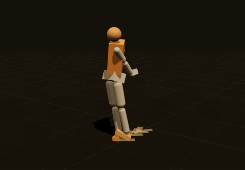
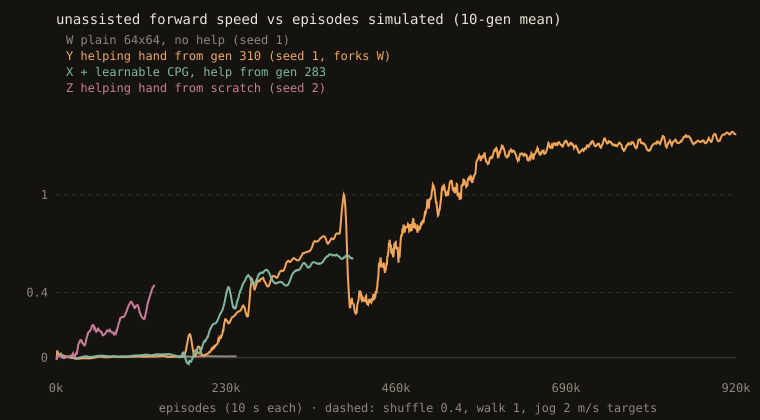
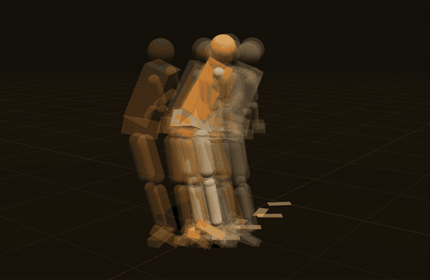
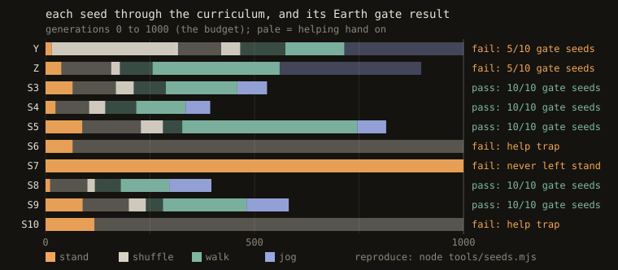
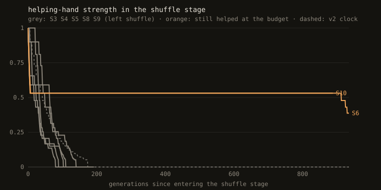

# upright

A 3D human ragdoll that learns to stand, walk and run by neuroevolution, with no motion capture and no hand-written gait. You can watch it live in the browser.

[](https://github.com/MarcoZorn/upright/actions/workflows/test.yml): every push replays all published walk brains on GitHub's machines, in Node and Bun, and checks each against its training hash.

**[Open the viewer](https://marcozorn.github.io/upright/)** · [v1 results](docs/RESULTS-V1.md) · [Devlog](docs/DEVLOG.md) · [Original plan](docs/PLAN.md)



*Generation 714, the first brain to pass the walk stage with no assistance: 8.1 m in 10 s, upright the whole time. Replayed in Chrome, it matches the training run's trajectory hash (`5d20c344`) bit for bit.*



### Watch the gradient



Press **g** in the viewer to show the 16 perturbed brains (8 antithetic pairs) that evolution strategies sampled around the selected generation, walking as ghosts next to it. The fallen ones fade out; the four furthest upright ones are orange. These aren't look-alikes: the page regenerates the training run's noise table and offsets, and the siblings are bit-identical to the brains the training workers evaluated (checked in `test.mjs`). Their weighted difference is the step that produced the next generation.

Real rigid-body physics ([Rapier](https://rapier.rs)'s cross-platform deterministic WASM build). The exact same simulation code runs headless in Node for training and in the page for viewing. Nothing on the hot path depends on the JS engine's `Math` functions. The test suite checks that V8 (Node) and JavaScriptCore (Bun) produce the identical trajectory, bit for bit, so a brain behaves in your browser exactly as it did in training.

**Where it's going:** [ROADMAP.md](docs/ROADMAP.md). Does a humanoid that taught itself to walk and run switch gaits at the same Froude number as people, and does it start *skipping* in lunar gravity?

## The body

15 rigid parts, about 71 kg and 1.74 m tall. There are 14 joints with 30 motorised degrees of freedom, each with a human-ish angle limit:

| joint | DOF |
|---|---|
| ankles, wrists | 2 each |
| knees, elbows | 1 each |
| hips, shoulders, waist, neck | 3 each |

**Senses (78 numbers):** joint angles and velocities, torso orientation, spin and velocity (in its own frame), a gait clock, pelvis height, foot contacts, and target speed. It has no idea where it is in the world.

**Brain:** an MLP (64×64 up to 512×512), optionally on top of a central pattern generator whose stride frequency and left/right phase are learned. It outputs a target angle per joint, which the joint motors chase.

| random brain, 0.9 s in | random brain, 3.4 s in |
|---|---|
|  |  |

## Status

- [x] Ragdoll stands in Rapier, in Node and in the browser. Physics is deterministic across JS engines.
- [x] Evolution strategies: antithetic sampling, rank shaping, Adam, worker threads capped at 70% of the machine, checkpoint/resume
- [x] Curriculum stand → shuffle → walk → jog → run, with honest metrics: credit for the fall itself is taken back
- [x] **It walks on its own.** Plain ES never took a step in 450 generations. With a helping hand that is annealed to zero (Yu, Turk & Liu 2018), it passed the walk stage unassisted on 7 of 10 seeds, and 5 of those walkers pass the strict gate below.
- [x] **It runs, sort of:** at 2 m/s the duty factor is 0.44 with 45% flight, but it's a two-footed *bound* (inter-leg phase ≈ 0.6 rad), not a human run. The arm with a learnable oscillator drifted to the same in-phase hop by itself. Details in the [devlog](docs/DEVLOG.md).
- [x] Gait instruments: duty factor, flight, cadence, inter-leg phase, skip rate, Froude number
- [x] Viewer:
  - orbit camera, slow motion, footprints
  - Earth/Mars/Moon gravity
  - a replay check against the training hash
  - ES siblings as ghosts (`g`)
  - click a body part to kick it
- [ ] Pass the jog stage with pushes on, then the run stage
- [x] **Pre-registered Earth gate: failed.** 5 of 10 training seeds produced a walker that passes; 8 were needed. Under the pre-registered kill criterion, the Moon/Mars experiment doesn't run with this recipe. Write-up: [RESULTS-V1.md](docs/RESULTS-V1.md); tally: [GATE.md](docs/GATE.md), which CI re-checks against the gate on every push.

  
- [ ] **v2, pre-registered ([PREREG-V2.md](docs/PREREG-V2.md)), training now on seeds 11–20.** Two of the five failures were a *help trap*: the brain learned to lean on the helping hand within a few generations, and the annealing rule then never fired again. v2 changes only that: the help also fades on a clock.

  
- [ ] NEAT baseline at the same budget. `neat.mjs` now runs the same curriculum and graduation tests (its stock settings made it a strawman, see the devlog); a mutation-scale sweep is queued behind v2.

## Run it

```bash
npm install
node test.mjs           # determinism (incl. V8 vs JavaScriptCore), save/load, ES, gait instruments
node stand.mjs          # headless smoke run
node train.mjs --run runs/x --hidden 64 --cpg   # train (resumes; Ctrl-C checkpoints)
node neat.mjs --run runs/neat --stage 2         # NEAT baseline (not run yet)
node compare.mjs runs/W:W runs/Y:Y              # progress chart -> docs/progress.svg
node gate.mjs runs/S3 runs/V11              # the pre-registered Earth gate on a run's walk graduate
node tools/status.mjs runs/V1*              # one line per run: stage, help, unassisted speed, time left
tools/resume.sh                             # after a reboot: restart whichever experiment queue stopped
tools/daily.sh                              # resume + write finished v2 seeds' gate results into GATE.md + status
python3 -m http.server  # then open http://localhost:8000
```

The viewer needs no build step: three.js and Rapier come from a CDN via an import map.

## Layout

```
src/body.js   ragdoll: parts, joints, limits, motors, senses
src/mlp.js    flat-parameter MLP, save/load
src/cpg.js    pattern generator with learned frequency and inter-leg phase
src/sim.js    environment, rollout, trajectory hash
src/task.js   reward and curriculum
src/es.js     evolution strategies
src/gait.js   gait instruments
src/ghosts.js rebuilds a generation's ES siblings exactly, for the viewer
src/trig.js   sin/cos from + and * only (same bits in every JS engine)
train.mjs     ES training, neat.mjs NEAT baseline, compare.mjs progress chart, gate.mjs the Earth gate
tools/        status.mjs (one line per run), assist.mjs (help chart), v2.sh (v2 seeds), clip capture
viewer.js     three.js viewer
test.mjs      checks
```

MIT.
