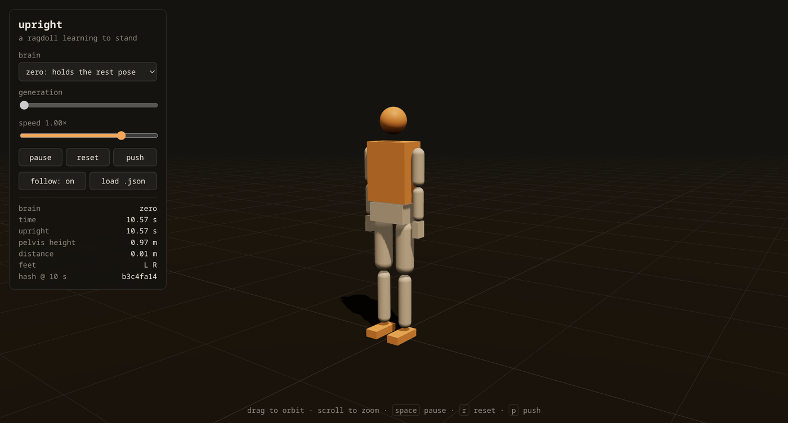
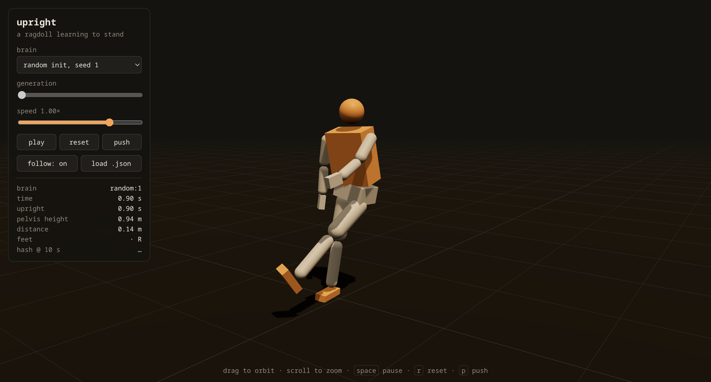
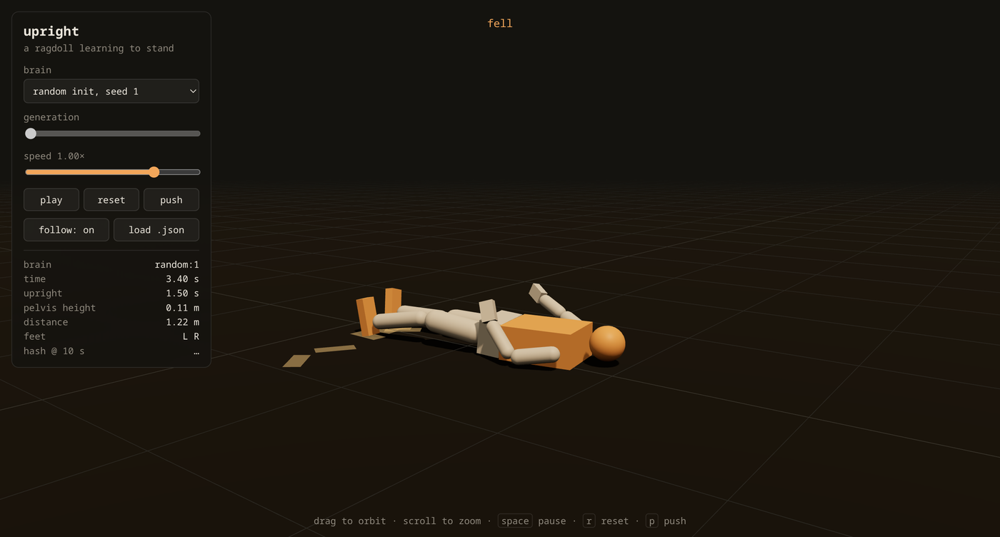

# upright

A 3D human ragdoll that learns to stand, walk and run by neuroevolution, with no motion capture and no hand-written gait. You can watch it live in the browser.

**[Open the viewer](https://marcozorn.github.io/upright/)** · [Devlog](docs/DEVLOG.md) · [Training plan](docs/PLAN.md)



Real rigid-body physics ([Rapier](https://rapier.rs)'s cross-platform deterministic WASM build). The exact same simulation code runs headless in Node for training and in the page for viewing. Nothing on the hot path depends on the JS engine's `Math` functions. The test suite checks that V8 (Node) and JavaScriptCore (Bun) produce the identical trajectory, bit for bit, so a brain behaves in your browser exactly as it did in training.

**Where it's going:** [ROADMAP.md](docs/ROADMAP.md). Does a humanoid that taught itself to walk and run switch gaits at the same Froude number as people, and does it start *skipping* in lunar gravity?

## The body

15 rigid parts, about 71 kg and 1.74 m tall. There are 14 joints with 30 motorised degrees of freedom, each with a human-ish angle limit:

| joint | DOF |
|---|---|
| ankles, wrists | 2 each |
| knees, elbows | 1 each |
| hips, shoulders, waist, neck | 3 each |

**Senses (78 numbers):** joint angles and velocities, torso orientation, spin and velocity (in its own frame), a gait clock, pelvis height, foot contacts, and target speed. It has no idea where it is in the world.

**Brain:** an MLP (64×64 up to 512×512), optionally on top of a central pattern generator whose stride frequency and left/right phase are learned. It outputs a target angle per joint, which the joint motors chase.

| random brain, 0.9 s in | random brain, 3.4 s in |
|---|---|
|  |  |

## Status

- [x] Ragdoll stands in Rapier, in Node and in the browser
- [x] Deterministic physics, brain save/load gives identical rollouts
- [x] Viewer: orbit camera, slow motion, footprints, push button, generation picker
- [x] Evolution strategies: antithetic sampling, rank shaping, Adam, worker threads (capped at 70% of the machine), checkpoint/resume
- [x] Curriculum stand → shuffle → walk → jog → run, with honest metrics: credit for the fall itself is taken back
- [x] NEAT baseline (my [neat-from-scratch](https://github.com/MarcoZorn/neat-from-scratch) engine) and an ES-vs-NEAT plot
- [x] Gait instruments: duty factor, flight, cadence, inter-leg phase, skip rate, Froude number
- [ ] A robust walk (in progress: see the [devlog](docs/DEVLOG.md))
- [ ] Run, then Mars and Moon gravity

## Run it

```bash
npm install
node test.mjs           # determinism (incl. V8 vs JavaScriptCore), save/load, ES, gait instruments
node stand.mjs          # headless smoke run
node train.mjs --run runs/x --hidden 64 --cpg   # train (resumes; Ctrl-C checkpoints)
node neat.mjs --run runs/neat --stage 2         # NEAT baseline
python3 -m http.server  # then open http://localhost:8000
```

The viewer needs no build step: three.js and Rapier come from a CDN via an import map.

## Layout

```
src/body.js   ragdoll: parts, joints, limits, motors, senses
src/mlp.js    flat-parameter MLP, save/load
src/cpg.js    pattern generator with learned frequency and inter-leg phase
src/sim.js    environment, rollout, trajectory hash
src/task.js   reward and curriculum
src/es.js     evolution strategies
src/gait.js   gait instruments
train.mjs     ES training, neat.mjs NEAT baseline
viewer.js     three.js viewer
test.mjs      checks
```

MIT.
