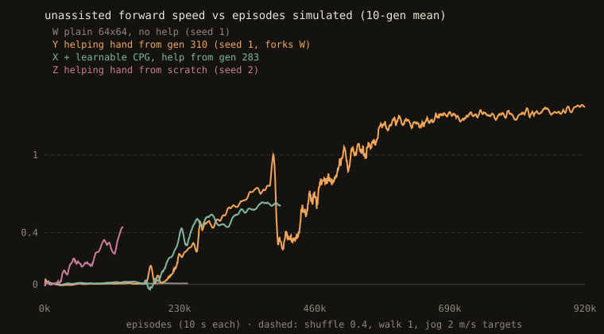
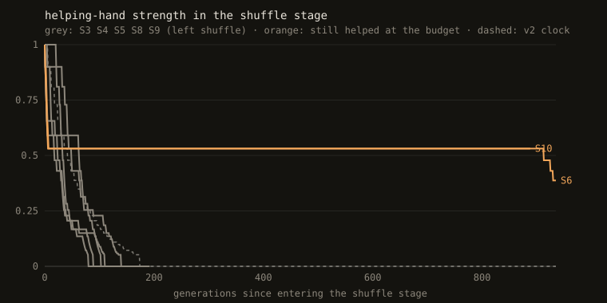

# Devlog

## 2026-11-02: a body that stands

**Body.** 15 rigid parts (pelvis, torso, head, thighs, shins, feet, upper and lower arms, hands), about 71 kg and 1.74 m tall. There are 14 joints with 30 motorised degrees of freedom:

- ankles 2 each
- knees 1 each
- hips 3 each
- waist 3
- neck 3
- shoulders 3 each
- elbows 1 each
- wrists 2 each

Every joint is a Rapier generic joint with only its real axes free, and each free axis gets a limit and a force-based position motor. Rapier's JS wrapper only exposes per-axis limits and motors on revolute and spherical joints, so I call the raw joint set (`world.impulseJoints.raw.jointSetLimits(handle, axis, …)`) directly. Self-collision is on except between jointed pairs.

**Brain.** MLP 73 → 512 → 512 → 30, tanh, 315,934 parameters. Output 0 maps to the rest pose and ±1 to the joint limits. The "zero brain" therefore means "hold the standing pose", which is a free sanity check for the physics.

**The bug of the day: the statue that wouldn't stand.** With all motors holding the rest pose, the body toppled after 1.4 s. Stiffer motors made it fall *faster*. Isolating it:

- every joint locked: stands forever
- only the ankles free: falls at 1.4 s whatever the stiffness
- ankle stiffness 0: stands *longer* (2.8 s) than with a stiff ankle
- the same 2-axis joint in isolation: tracks targets exactly, so the motor semantics were fine

The cause is solver convergence. The ankle motor pushes a 1.2 kg foot that is pinned to the ground under 68 kg of body. With Rapier's default 4 PGS iterations, the motor and the foot contacts never agree within a step, so energy leaks in and the ankle swings ±0.3 rad until the body goes over. Raising the iteration count alone fixes the statue (50 iterations: ankle sway < 0.03 rad). The final settings:

- 16 solver iterations
- 2.5 kg feet (heavy for a human, but it tames the mass ratio)
- ankle stiffness 1000 N·m/rad, capped at 300 N·m
- motor damping at 5% of stiffness (10% was worse)

The zero brain now stands 60 s+ with < 1 cm of drift. Cost: about 250 ms per 10 s episode, about 40× real time per core.

**Determinism.** Each run gets a trajectory hash (FNV over the float32 bits of every part's pose at every brain step). The checks:

- same brain twice: identical
- same brain in a worker thread: identical
- a brain saved to JSON and loaded back: identical
- the browser (Rapier WASM via CDN, Chrome) reproduces Node's zero-brain hash `b3c4fa14` exactly

Caveat: brain forward passes use `Math.tanh`, which isn't guaranteed bit-identical across JS engines. Node and Chrome share V8; Firefox might drift on a trained brain. If that matters, a hand-written tanh fixes it.

**Random brains** flail and fall within about 1.5 s. Good: the task isn't trivial.

Next: the training code, after the plan in [PLAN.md](PLAN.md) is agreed.

## 2026-11-02 (evening): training loop in, walking not yet

- **Built:** ES (shared noise table, antithetic pairs, centered ranks, Adam), the stand/walk/run task with seeded pushes, a worker pool with checkpoint/resume, the NEAT baseline (my neat-from-scratch engine, vendored) and the ES-vs-NEAT plot. Training is capped at 70% of the CPUs and runs at nice 19.
- **Senses:** torso-frame linear velocity added (vestibular, not global position).
- **Tanh:** brains now use the Padé tanh from neat-from-scratch, so a trained brain replays bit-identically in every JS engine.
- **Hyperparameters:** a sweep on the stand stage picked σ = 0.005 and lr = 0.001. σ = 0.02 or lr = 0.01 wreck the zero-init brain within a few generations.
- **Stand:** graduated at gen 2. The zero-init output layer means generation 0 already holds the rest pose.
- **Walk, gens 3–24:** stuck at the local optimum of standing still. Speed is 0.00 at targets 0, 1 and 3 alike. Population fitness climbs towards the centre brain's (170 → 385), so ES is making the brain *insensitive to noise* rather than finding a gait.

Next things to try:
1. Larger σ in the walk stage, for more exploration.
2. A phase clock input (sin/cos of time). It's the standard trick for gaits with a memoryless MLP.
3. A reward that pays for forward lean and stepping before it pays for speed.
4. A larger population.

## 2026-11-02 (night): why it dives, determinism for real, a rhythm to explore with

**Why every walk attempt turned into a dive.** Three sweeps (σ 0.005–0.02, alive bonus 0.5–1, push scale 0.3–1, with a 1 s clock input) all ended the same way: lunge forward, fall at about 1.8 s, eval fitness dropping from 440 (standing) to 30–80. The arithmetic behind it:
- The output layer starts at zero, so early on the noise on each joint target is about σ·√(hidden·E[h²]), roughly 11σ for 512 hidden units.
- At σ = 0.02 that's about 23% of every joint's range, on all 30 joints at once. Practically every perturbed sibling falls.
- ES then ranks fallers against fallers, and the one that falls *forward* fastest wins.
- At σ = 0.005 the siblings survive, but random static offsets on 30 joints are never a footstep, so nothing pulls towards walking.

**Metric hygiene.**
- `speed` used to be `pelvis z / upTime`, which counts the topple itself. A brain that just tips forward used to read as 0.4–0.6 m/s; it now reads −0.02.
- On a fall, the last second of speed credit and distance are taken back.
- The fall test is stricter: head below 1.3 m or torso past 45°. It used to be head below 1.0 m.

**Curriculum.**
- The speed ramp is now stand → shuffle 0.4 → walk 1 → jog 2 → run 3 m/s.
- There are no pushes until it walks.
- A stage only graduates when the *perturbed population* also survives (≥ 80% in stand). The old stand stage graduated at gen 2 by luck; the brain didn't really balance, so every exploration around it toppled.
- With the strict gate, a 64×64 net passes stand with 95% of its siblings upright. A 512×512 net still hadn't passed at gen 26.

**Determinism, for real this time.** The "same bits in every JS engine" claim wasn't true. The npm `rapier3d-compat` build only promises determinism on one machine, and `Math.sin`, `asin`, `log` and `**` were on the hot path; Node and Chrome only agreed because both are V8. Now:
- Rapier's deterministic build (aliased in `package.json`, and the browser import map points at it). It is about 7% slower.
- A polynomial sine (only `+` and `*`, error < 1e-6).
- The raw half-angle term instead of `asin`.
- A rejection-sampled push direction.
- An Irwin-Hall noise table instead of Box-Muller.
- Running products for Adam's bias correction.

`test.mjs` now runs the same random 316k-param brain with pushes under Bun (JavaScriptCore). Its trajectory hash and fitness match V8 exactly.

**Structured exploration.** `src/cpg.js` adds a central pattern generator: per joint, offset + A·sin(phase + φ). The right leg mirrors the left. Stride **frequency and inter-leg phase are learned**, starting at 1 Hz and π (an alternating walk), so a skip or a faster cadence isn't ruled out by construction. That matters for the Moon question in [ROADMAP.md](ROADMAP.md). A residual MLP, starting at zero, adds corrections on top. `src/gait.js` measures duty factor, flight fraction, cadence, inter-leg phase, skip rate and Froude number from foot contacts. σ now adapts to keep 40–80% of the perturbed siblings upright.

Running now, side by side, about 11 workers each:
- **A:** the CPG alone, MLP frozen.
- **B:** a plain 64×64 MLP, the no-CPG control arm.

### What didn't work tonight (so I don't repeat it)
All runs used 64×64 nets, 7–11 workers each and honest metrics.

| run | setup | result |
|---|---|---|
| cpgA | CPG only (MLP frozen), alive 1, σ_cpg 0.03, adaptive σ, shuffle stage | 200 gens standing still: amplitudes stayed ≈ 0, 0 footsteps |
| mlpB | plain MLP, same reward | passed stand at ~gen 130 (strict gate); then 60 gens standing still in shuffle |
| cpgA/mlpB + `--alive 0` | resumed without the alive bonus | both dive again within 15 gens (honest speed ~0.2 m/s, 20% upright, 0 steps) |
| P / S | CPG, alive 0.3 or 0, longer rewind (3 s / whole run), fall penalty 30 / 10 | standing still, Adam step shrinking to 0.01 |
| Q | plain MLP, alive 0.3, fall penalty 30, from stand | collapsed: 7% upright after 700 short gens |
| T / U / V | CPG, fixed σ_cpg 0.08 / 0.15 / 0.3, 3 s episodes, no alive bonus | U ran off to the minimum frequency; 3 s episodes are too short for the gait metrics to say anything |

**What I think is going on.** Near zero amplitude, the CPG landscape is flat: a small oscillation just shakes the body in place and earns nothing. The amplitude where a foot actually leaves the ground is a cliff (it falls) rather than a slope. The adaptive σ also shrinks the noise whenever siblings fall, which is the opposite of what an open-loop oscillator needs.

**The bigger mistake.** I kept killing runs after 10–20 minutes. ES needs on the order of 10⁵ episodes for MuJoCo's humanoid; the first main run stopped at gen 24, which is ~12k episodes. So the plain setup has never had a fair budget. For the rest of the night, two long runs (W: plain 64×64; X: 64×64 + learnable CPG), 256 pairs, untouched.

## 2026-11-03 (early morning): the helping hand gets it stepping

**The control arm stayed stuck.** W (plain 64×64 MLP) never took a step in 450 generations, about 230k episodes. Its fitness plateaued at ~420 (standing earns 450 at best). Among 48 perturbed siblings of its gen-299 brain, none of the upright ones travelled more than 0.18 m, so the only gradient was "lean a little further forward". Stepping simply isn't in the neighbourhood ES samples.

**Helping hand** (`--assist`, after Yu, Turk & Liu 2018):
- upright springs on the torso and pelvis
- body-weight support of up to 40%
- a gentle pull towards the target speed

All of it is scaled by `assist`. It decays ×0.9 every generation in which the assisted brain stays up and reaches 60% of the target speed, restarts at each new stage, and **a stage only graduates at assist = 0**. Every generation also runs 4 unassisted ("bare") evals, so the log always shows what the brain can do alone.

Two traps on the way:
1. The help forces were first held for a whole brain step (4 physics steps). The explicit damping term went numerically unstable and the body launched itself at 0.5 s; it now recomputes every physics substep.
2. With the help on, nearly every sibling survives, so survival-targeted σ climbed to 0.07 and the population started flailing. σ is now capped at 0.03.

**Result so far (run Y, started from W's gen-310 brain):**

| gen | assist | steps / episode | duty | speed with help | bare: upright / speed |
|---|---|---|---|---|---|
| 310 | 1.00 | 0 | 1.00 | 0.04 | 100% / 0.01 |
| 318 | 1.00 | 12 | 0.54 | 0.06 | 100% / 0.01 |
| 333 | 0.48 | 68 | 0.53 | 0.46 | 17% / 0.14 |
| 408 | 0.11 | 36 | 0.80 | 0.27 | 60% / 0.12 |

The footsteps appeared within 8 generations of switching the help on, after 300 generations without it.

**By ~02:30 both arms walk on their own.**
- **Y (plain 64×64):** passed shuffle at gen 465 with zero assist. In the walk stage, at assist 0.1, its bare evals are 100% upright at 0.50 m/s.
- **Replay check:** the gen-500 brain (`brains/Y-gen00501.json`), replayed in Chrome, covers 5.7 m in 10 s, and its trajectory hash `ab1d9edf` matches the one training stored. That replay is the clip at the top of the README.
- **X (64×64 + learnable CPG):** passed shuffle at gen 423.

Two arms, two gaits. Over 4 seeds, from `src/gait.js`:

| brain | Δφ (CPG param) | measured inter-leg phase | duty | flight | cadence (touchdowns/s) | speed |
|---|---|---|---|---|---|---|
| X gen 423 | 0.57 rad | ≈ 0.97 rad (nearly in phase) | 0.78 | 0.16 | 5.4 | 0.31 m/s |
| Y gen 500 | (none) | ≈ 2.2 rad (closer to alternating) | 0.79 | 0.14 | 4.6 | 0.47 m/s |

- **X's learned gait.** Starting from Δφ = π (alternating), the CPG arm drifted its inter-leg phase steadily down (π → 2.7 → 1.7 → 1.1 → 0.57 over ~250 gens). The result is a two-footed shuffle-hop, on Earth. The CPG didn't force that: the shuffle stage rewards small, safe forward progress, and moving both feet together turned out to be a safe way to get it.
- **Not walking yet in the human sense.** Both cadences are fast micro-steps; a human takes about 2 steps per second. Neither brain changes speed with the target speed yet; that's what the walk stage is now training.

## 2026-11-03 (~04:00): Y passes the walk stage; first gravity smoke test

**Y passed the walk stage at gen 714 with zero assist** (bare evals ≥ 0.8 m/s at the 1 m/s target, ≥ 90% upright). Gait of that brain over 4 seeds:

| target | upright | speed | duty | flight | cadence | inter-leg phase |
|---|---|---|---|---|---|---|
| 0 | 100% | 0.57 | 0.68 | 0.25 | 3.4 | 1.3 |
| 0.4 | 100% | 0.66 | 0.63 | 0.28 | 4.1 | 1.2 |
| 1 | 100% | 0.81 | 0.56 | 0.32 | 4.7 | 1.5 |
| 1.5 | 100% | 0.92 | 0.51 | 0.35 | 5.3 | 2.1 |

- **Human-like trends:** speed follows the target, and as it speeds up the duty factor falls and the cadence rises, the same direction as in human gait.
- **Not human yet:**
  - It bounces, with a flight phase of 25% even at target 0.
  - It can't hold still: it does 0.57 m/s when asked to stand.
  - It doesn't reach 1 m/s, so the pre-registration's Earth gate (1 m/s on 8/10 seeds) isn't met.
- **Replay:** in Chrome, 8.1 m in 10 s, and the trajectory hash `5d20c344` matches training. That's the clip in the README.

**Gravity smoke test (pipeline check, not a result):** the same Earth-trained brain, run at g = 3.71 and 1.62, stays up only 14–30% of the time on Mars and 8% on the Moon. Its motors are tuned to push against 9.81, so in low gravity it launches itself. That's expected, and it's why the pre-registration trains from scratch at each gravity.

**Reproducibility run Z started:** seed 2, from scratch, helping hand on from generation 0. Y's result came from a single run that forked from W at gen 310; Z checks whether the recipe works without that history.

**Stopped here (morning of 2026-11-03).**
- **Y (jog stage), at gen 1496, no assist:** at the 2 m/s target it does 1.33 m/s, upright 79% of the time, duty factor 0.48. The help has fully decayed, but it hasn't passed the jog stage yet.
- **Z (seed-2 reproduction, help only after stand):** restarted, only 15 gens in, still in the stand stage. The first Z attempt (help from gen 0) failed and its log is kept as `runs/Z/log-attempt1.jsonl`.
- **Resume:**
  - `node train.mjs --run runs/Y --workers 10`
  - `node train.mjs --run runs/Z --workers 11`

## 2026-11-04: it reproduces; the ES population, visible

**Seed-2 reproduction (run Z).** Fresh start, helping hand from the shuffle stage on, no help in stand.
- Passed stand at gen ~43 and shuffle at gen ~184, both with zero assist.
- At gen 232 in the walk stage, at assist 0.13, its bare evals are 100% upright at 0.35 m/s.
- Y needed 310 unassisted gens (as W) + 155 more to pass shuffle. Z did it in 184 from scratch.

So "help, then anneal it away" isn't a one-seed fluke, and starting the help early is what costs nothing. Two seeds still isn't a result with error bars; the pre-registration's Earth gate asks for 8/10.

**Y in the jog stage** has plateaued around 1.35 m/s at the 2 m/s target, ~75% upright, duty ≈ 0.48. It needs 1.6 m/s and 90% to graduate.

**Ghost siblings in the viewer** (press `g`). For a published brain, the page regenerates the run's 16M-entry noise table (Irwin-Hall, seed 12345) and the generation's offsets (`seedHash(seed, gen)`), then builds the 16 perturbed brains ES evaluated around it.
- `test.mjs` checks they're bit-identical to what a training worker computes, including the float32 rounding of the CPG noise scale.
- They walk next to the solid centre brain. Fallen ones fade; the four furthest upright are orange.
- The first version ranked by raw distance, which coloured a sibling that had *dived* forward as the best. That's the same bug as the reward's lunge problem, now fixed in the picture too.
- Clip: `docs/ghosts.gif`.

**Y's "run" is a bound.** Y's gen-1869 brain, measured without pushes:

| target | upright | speed | duty | flight | cadence | inter-leg phase |
|---|---|---|---|---|---|---|
| 0 | 7% | (falls) | | | | |
| 1 | 100% | 1.16 | 0.55 | 0.37 | 4.4 | 0.64 |
| 1.5 | 100% | 1.26 | 0.50 | 0.40 | 4.8 | 0.96 |
| 2 | 100% | 1.44 | 0.44 | 0.45 | 5.3 | 0.58 |
| 2.5 | 100% | 1.58 | 0.43 | 0.46 | 5.5 | 0.60 |

- **It runs by the duty-factor definition:** duty < 0.5 and 45% flight at 2 m/s. In the jog stage it's ~78% upright only because the pushes are back on.
- **It's a two-footed bound, not a human run.** The inter-leg phase is ≈ 0.6 rad, so both legs move nearly together.
- **The CPG arm X found the same thing on its own:** Δφ drifted from π to 0.16. So on Earth, with this body and reward, speed is reached by hopping, with or without an oscillator.
- **It forgot how to stand.** At target 0 it falls.

**What this means for the pre-registration.** The Moon hypothesis (H2: skip/hop at low g) now needs a stronger control than planned. If the Earth baseline already hops at speed, "it hops on the Moon" says nothing about gravity. Only a *change* in Δφ or skip rate versus Earth, at matched Froude number, would. I'm adding that comparison as an amendment rather than editing PREREG.md, so the original timestamp still means something.

## 2026-11-06: the Earth gate, and how run Z destroyed itself

**`gate.mjs`** applies the pre-registered Earth gate to each run's latest brain. A brain passes if, at a 1 m/s target with no pushes and no help, it stays upright for the whole 10 s and averages ≥ 0.8 m/s on at least 8 of 10 fresh seeds; training never uses those seeds.
- **Y** (gen 1969): **passes**, 10/10, 1.12 m/s, duty 0.55.
- **Z** (gen 489): fails, upright 10/10 but 0.73 m/s.

The experiment needs 8 of 10 *training runs* to pass. Seeds 3 and 4 (runs S3, S4) started today with Z's recipe.

**Z collapsed in the jog stage.** It passed walk at gen 559, then failed in two stacked ways:
1. **The help reset to 1 on entering jog, and at 2 m/s its forward pull topples the body.** Helped, Z stayed up 33% of the time; its unassisted evals in the same generation were 100% upright at 1.06 m/s.
2. **σ had no floor.** Survival-targeted σ shrank 15% per generation towards 0. At σ → 0 the ES estimate is pure noise, and Adam turns noise into full-size steps (|Δ| ≈ 2 per generation). By gen 600 the brain couldn't stand.

**Fixes:**
- **σ is floored at 0.003.**
- **The help is annealed whenever the bare brain does at least as well as the helped one**, and is now used only in the shuffle and walk stages: its job is making stepping discoverable, not running.
- **`--init brain.json`** restarts a run from a saved brain, rebuilding the obs-norm stats from its mean and std.
- **`--warmup N`** ramps the learning rate. My first restart without it moved every parameter by the full learning rate on Adam's first step and dropped the bare evals from 95% to 21% upright in one generation.
- **`--fresh` now also clears `gens/`.** Before, leftover brains from Z's first attempt made the gate report its latest brain as "upright 2%".

Z2 restarts from Z's gen-559 walk graduate in the jog stage with all of the above.

## 2026-11-07: gate so far, and a dead end in the recipe

Gate tally: seeds 3 and 4 **pass** (10/10 at 0.90 m/s); seeds 1 and 2 fail (5/10 at 0.80, the threshold flaw in amendment 2). Amendment 3 raised the walk graduation threshold; amendment 4 set a 1000-generation budget. Seeds 5–7 are training.

**Seed 6 is stuck in a help trap.** It has been in the shuffle stage with assist frozen at 0.53 since about gen 270. The help anneals when the helped brain copes (upright ≥ 90% and ≥ 60% of the target speed) or when the bare brain does at least as well. S6 does neither:
- helped, it stands 90% of the time at 0.07 m/s
- bare, it's upright 3%

It has learned to lean on the help and stand still, which is the stand-still optimum again, only with support. I'm not changing the algorithm for one seed mid-run (the pre-registration requires the same algorithm for every seed), so S6 keeps going and fails at gen 1000 if it stays stuck. For a future recipe, the help should anneal on a schedule as well as on performance, so it can't freeze.

## 2026-11-07 (evening): the gate fails; no Moon experiment with this recipe

| | seeds |
|---|---|
| pass | 3, 4, 5 (walk graduates at 0.89–0.90 m/s, 10/10 gate seeds each) |
| fail | 1 and 2 (graduates on the threshold, 5/10), and 7 (never left the stand stage in 1000 gens) |

With three fails, 8 of 10 is out of reach. The kill criterion in [PREREG.md](PREREG.md) says the gravity experiment isn't run, so it isn't.

That is a real result: **this recipe (64×64 MLP, OpenAI-ES, a helping hand annealed per stage) produces a gate-quality walker on about half of the seeds so far.** The three failure modes are all logged:
- threshold flaw: seeds 1 and 2, fixed by amendment 3 for later seeds
- help trap: seed 6
- never learning to balance well enough to pass the strict stand gate (80% of perturbed siblings upright): seed 7

Seed 6 runs to its budget, and seeds 8–10 are being trained so the reliability estimate covers all ten. A Moon experiment would need a new recipe, a new pre-registration, and new seeds.

## 2026-11-07 (late): all ten seeds decided

| | seeds |
|---|---|
| pass | 3, 4, 5, 8, 9 (walk graduates at gens 296–746, 0.89–0.90 m/s, 10/10 gate seeds each) |
| fail | 1, 2 (threshold flaw), 6, 10 (help trap), 7 (stand stage) |

**5 of 10.** Seed 10 fell into the same help trap as seed 6: the assist froze at 0.531 (0.9⁶) around gen 160 and never moved again. At gen 1000, helped, it was upright 91% of the time at 0.09 m/s; bare, 4%. Two of ten seeds hitting the identical trap at the identical assist level makes the fix for a v2 recipe concrete: decay the help on a schedule too, not only on performance.

Every seed that graduated walk under the 0.9 m/s threshold went on to pass the gate. The recipe's weak points are getting there (stand, shuffle with help), not walking once it gets there.

## 2026-11-08: how the help trap forms, and v2

The trap isn't a slow slide. Both trapped seeds froze in the **first 7 generations** of the shuffle stage, at the same 0.531 (six ×0.9 fades). The logs show the mechanism:
- At shuffle entry the stand graduate is better *without* help (the forward pull tips it over), so the "bare does at least as well" rule fades the help every generation.
- Meanwhile ES adapts to the help. Within about six generations the helped brain is upright more often than the bare one (S10 gen 6: 100% helped vs 65% bare).
- From then on neither rule fires: bare is worse, and the helped brain stands still, so it never reaches the 0.24 m/s needed to count as coping. The help stays at 0.531 forever.

The seeds that walked kept fading because their helped brains started moving before that crossover.

v2 ([PREREG-V2.md](PREREG-V2.md)) adds a clock: the help can't be stronger than 0.9^floor(k/6) after k generations in a stage (the dashed line), so it reaches zero by k = 174 regardless. Seeds 11–20 are training now, three at a time. `node tools/assist.mjs runs/S3 … --clock 6` redraws the chart.

## 2026-11-08: the NEAT baseline would have been a strawman

`neat.mjs` was written days ago and never run. A smoke run showed every genome falling within a fraction of a second: 32 ten-second episodes took 0.9 s, upright 1% of the time. The vendored NEAT defaults suit small game networks. Here a genome starts fully connected, 79 × 30 = 2,370 connections, all N(0, 1), and every mutation moves ~80% of them by N(0, 0.4) and resets ~8% to fresh N(0, 1). ES starts from a zeroed output layer (hold the neutral pose, which stands) and explores at σ = 0.01.

Comparing against that would make ES look good for free. The mutation scale is now set by flags (`--initWeight --weightStep --pWeight --pWeightReplace`). With `--initWeight 0 --weightStep 0.02 --pWeightReplace 0` the first generation stands 100% of the time, like ES at gen 0. The baseline gets a small sweep of these before any comparison is claimed. That sweep waits for the v2 seeds, because both together would go over the 70% CPU budget.
