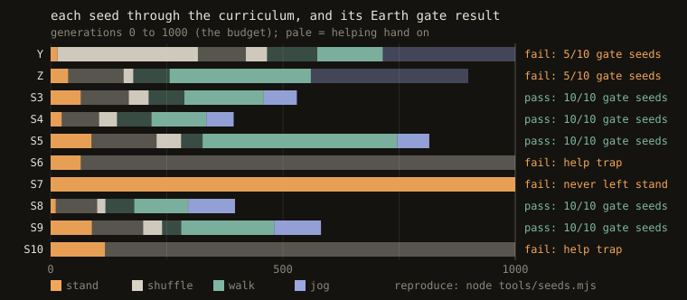

# Earth gate tally

The gate ([PREREG.md](PREREG.md), amendments [2](PREREG-AMENDMENT-2.md) and [3](PREREG-AMENDMENT-3.md)): each training seed is judged by its walk-stage graduate. That brain must walk at a 1 m/s target, with no pushes and no help, upright for all 10 s and averaging ≥ 0.8 m/s, on ≥ 8 of 10 fresh seeds. The Moon and Mars experiment runs only if ≥ 8 of 10 training seeds pass. A run that hasn't passed the walk stage by generation 1000 fails ([amendment 4](PREREG-AMENDMENT-4.md)). Reproduce with `node gate.mjs runs/<run>`.

| seed | run | walk graduate | result | gate seeds | mean speed |
|---|---|---|---|---|---|
| 1 | Y | gen 714 | fail | 5/10 | 0.80 |
| 2 | Z | gen 559 | fail | 5/10 | 0.80 |
| 3 | S3 | gen 458 | **pass** | 10/10 | 0.90 |
| 4 | S4 | gen 334 | **pass** | 10/10 | 0.90 |
| 5 | S5 | gen 745 | **pass** | 10/10 | 0.89 |
| 6 | S6 | none: help trap, leans on the help at gen 1000 | fail (budget) | 0/10 | – |
| 7 | S7 | none: never balances well enough to leave stand at gen 1000 | fail (budget) | 0/10 | – |
| 8 | S8 | gen 295 | **pass** | 10/10 | 0.89 |
| 9 | S9 | gen 480 | **pass** | 10/10 | 0.89 |
| 10 | S10 | none: help trap, leans on the help at gen 1000 | fail (budget) | 0/10 | – |

**Final (2026-11-07): 5 pass, 5 fail. The gate is not met (needs 8). Under the pre-registered kill criterion, the Moon/Mars experiment does not run with this training recipe.** The recipe produces a gate-quality walker on 5 of 10 seeds. Failure modes: threshold flaw (1, 2), help trap (6, 10), never passed the stand stage (7).
Rows are written by `node tools/tally.mjs runs/<run> …` from the gate itself. *(2026-11-10: the hand-written rows for seeds 3, 4, 5, 8 and 9 gave the graduate's file number, which is one past its generation; e.g. S3's graduate is `S3-gen00459.json`, evaluated at gen 458. Results unchanged.)*
Seeds 1 and 2 graduated under the old 0.8 m/s walk threshold (see amendment 3); seeds 3 and 4 under 0.9.

`node tools/seeds.mjs runs/Y runs/Z runs/S3 … runs/S10` redraws it from the logs and this table.

## v2 (clocked help, [PREREG-V2.md](PREREG-V2.md))

Same gate, same 8-of-10 rule, seeds 11–20. Filled in as runs finish; reproduce with `node gate.mjs runs/V11 …`.

| seed | run | walk graduate | result | gate seeds | mean speed |
|---|---|---|---|---|---|
| 11 | V11 | (training) | | | |
| 12 | V12 | (training) | | | |
| 13 | V13 | (training) | | | |
| 14 | V14 | (queued) | | | |
| 15 | V15 | (queued) | | | |
| 16 | V16 | (queued) | | | |
| 17 | V17 | (queued) | | | |
| 18 | V18 | (queued) | | | |
| 19 | V19 | (queued) | | | |
| 20 | V20 | (queued) | | | |
