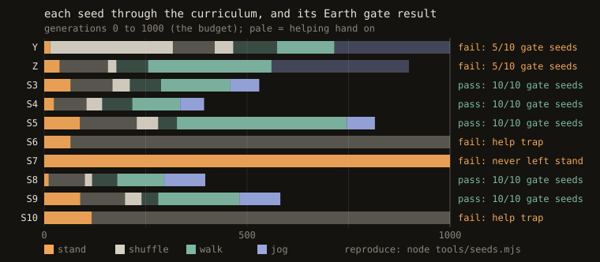

# v1 results: a pre-registered Earth gate, failed 5/10

**Summary.** A 64×64 MLP trained by OpenAI-style evolution strategies, with a helping hand annealed to zero, learned an unassisted walk that passes a strict gate on **5 of 10 training seeds**. The pre-registration needed 8, so the planned Moon/Mars gait experiment was not run. All five failures fall into three distinct failure modes, each identifiable from the training logs. None of them is a failure to walk once a brain reaches the walk stage.



## Setup
- **Body:** a 15-part, 30-DOF Rapier ragdoll, ~71 kg, 1.74 m, joints driven by PD motors toward the brain's target angles. 78 senses, no global position.
- **Brain:** MLP 78→64→64→30 (11,166 parameters), no pattern generator.
- **ES:** 256 antithetic pairs per generation, centered ranks, Adam (lr 0.01, L2 0.005). σ starts at 0.01 and, after the stand stage, is adapted to keep 40–80% of perturbed siblings upright, within [0.003, 0.03].
- **Curriculum:** stand → shuffle (0.4 m/s) → walk (1 m/s) → jog → run.
  - A stage graduates when the brain's own evals are ≥ 90–95% upright, **≥ 70–80% of its perturbed siblings are upright**, and it reaches the stage's speed. Walk needs > 0.9 m/s, from amendment 3 on.
  - Graduation never happens while the brain is being helped.
- **Helping hand** (Yu, Turk & Liu 2018): upright springs, 40% body-weight support and a forward pull, scaled by `assist`. It is on in shuffle and walk, off in stand and from jog on. It fades ×0.9 per generation when the helped brain copes (≥ 90% upright at ≥ 60% of target speed), or when the brain does at least as well without it.
- **Gate:**
  - The judged brain is the walk-stage graduate.
  - It runs at a 1 m/s target, no pushes, no help, on 10 fixed seeds never used in training.
  - It passes a seed if upright for all 10 s and averaging ≥ 0.8 m/s, and passes the gate on ≥ 8 of 10 seeds.
  - Budget: 1000 generations per run (amendment 4).
- **Pre-registration:** [PREREG.md](PREREG.md) and amendments [1](PREREG-AMENDMENT-1.md)–[4](PREREG-AMENDMENT-4.md). Every amendment was committed before the result it could affect, and the table records which rule applied to which seed.

## Results

| | seeds | walk graduate | gate |
|---|---|---|---|
| pass | 3, 4, 5, 8, 9 | gens 295–745 | 10/10 each, 0.89–0.90 m/s |
| fail: threshold flaw | 1, 2 | gens 714, 559 | 5/10 each, 0.80 m/s |
| fail: help trap | 6, 10 | none in 1000 gens | – |
| fail: never left stand | 7 | none in 1000 gens | – |

Per-seed numbers: [GATE.md](GATE.md). Every walk graduate is in [`brains/`](../brains) with a replay hash, and CI replays each one on every push.

## The three failure modes

**1. Threshold flaw (seeds 1, 2).** Walk graduation required > 0.8 m/s on training evals, the same number the gate demands. A graduate that just cleared it on training seeds then sat right on the line on fresh ones, and passed 5 of 10. This is a design error, not a learning failure. [Amendment 3](PREREG-AMENDMENT-3.md) raised graduation to 0.9 m/s for every seed not yet graduated, before their results were known. Every seed that graduated under 0.9 passed the gate.

**2. Help trap (seeds 6, 10).** The helping hand froze at 0.531 = 0.9⁶ for 900 generations (seed 6: gens 72–977, then three late fades to 0.387; seed 10: until the budget ran out) ([chart](assist.svg)). It forms in the first ~7 generations of shuffle:
- At first the stand graduate does better *without* help, because the forward pull tips it over, so the "bare does at least as well" rule fades the help every generation.
- Meanwhile ES adapts to the help. Within ~6 generations the helped brain is upright more often than the bare one (seed 10, gen 6: 100% vs 65%).
- From then on neither rule fires. The bare brain is worse, and the helped brain stands still, so it never reaches the 0.24 m/s that counts as coping.

At gen 999, seed 10 was upright 84% of the time with help and 3% without.

**3. Never left stand (seed 7).** The brain itself met the stand bar (≥ 95% upright) in 88 generations, but its perturbed siblings never reached 80% upright: their best was 78.3%. The graduation test asks for a balance that survives small changes to the weights. With σ fixed at 0.01 in the stand stage, seed 7 found only fragile balances, and over its last 200 generations it averaged 56% upright.

## What the passes have in common
All five got the help to zero within 41–140 generations of entering a stage, and none spent more than 465 generations in walk. Once a run reached the walk stage without help, it learned to walk on every seed. The weak points of the recipe are the transitions into walking: balancing robustly enough to leave stand, and not leaning on the help in shuffle.

## What changed next
[v2](PREREG-V2.md), seeds 11–20, changes only the help: it also fades on a clock, reaching zero 174 generations into a stage, which removes the help trap by construction. It does not address seed 7's failure mode. Its own runs show a fourth one, standing still without help in shuffle (seed 11), that v1 never hit.

## Reproducing
```bash
npm install && node test.mjs        # incl. replaying every published walk graduate against its proof hash
node gate.mjs runs/S3               # the gate on one run's walk graduate (logs and brains are in the repo)
node tools/seeds.mjs runs/Y runs/Z runs/S3 runs/S4 runs/S5 runs/S6 runs/S7 runs/S8 runs/S9 runs/S10
node tools/assist.mjs runs/S3 runs/S4 runs/S5 runs/S6 runs/S8 runs/S9 runs/S10 --clock 6
```
Training a seed from scratch: `node train.mjs --run runs/S3 --seed 3 --hidden 64 --pairs 256 --noise 16000000 --lr 0.01 --sigma 0.01 --assist 1` (a few hours on 7 workers; it resumes after Ctrl-C).
